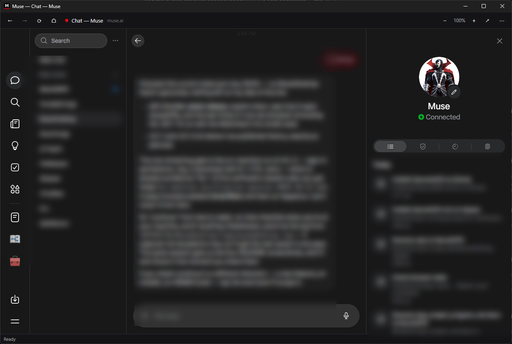
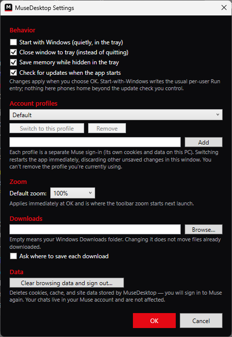

# MuseDesktop

A native Windows desktop client for [Muse](https://muse.ai) — Meta's personal AI agent.

Muse ships apps for iOS, Android and macOS, and a web app at muse.ai — but no Windows app. MuseDesktop fills that gap: a small, focused Windows program that keeps Muse one click away, signed in, with the desktop behaviors a browser tab can't give you.

> MuseDesktop is an independent open-source project. It is not made by, endorsed by, or affiliated with Meta. "Muse" is a product of Meta; this app simply displays muse.ai in a native window.

## TL;DR

Muse has no Windows app, so this is one: a small native program that opens muse.ai in its own window, keeps you signed in, and lives in the system tray. It adds the desktop touches a browser tab can't — downloads with progress, cancel, and a history window, multiple sign-in profiles, a settings window, update notices, and sensible link handling. Free, open source (MIT), no telemetry; you only need Windows 10/11 (x64 or ARM64) and the WebView2 Runtime (usually already installed). Download the installer from Releases and run it.

## What you get

- **A real app, not a tab** — its own window, taskbar icon, and Alt-Tab entry; no browser chrome competing for space.
- **Stay signed in** — a dedicated WebView2 profile on your PC keeps your Muse session between launches, and the app reopens the last Muse page you were on.
- **Tray support** — the tray menu runs the whole app while it's hidden: Open, New window, Reload, **Downloads** (the manager, plus your newest finished files), **Settings…**, **Switch profile**, a web-view status line, and Exit. The tray icon wears your active profile's accent color as a small dot, and shows an unread-count badge on the icon and taskbar button **only** when Muse's page title itself carries one (like "(2) Muse") — it never guesses. Closing the window minimizes to the tray by default; after a while hidden (1 / 5 / 15 minutes, or never — your choice in Settings) the web view suspends to free memory until you come back, and suspend always waits out downloads and stays out of the way after the microphone has been used, so a voice session is never slept under. Single-click instead of double-click to reopen is a Settings option, and right-clicking the **taskbar** button offers a Jump List: Open Muse, Settings, and your most recent profiles. "Start with Windows" and "start in the tray" are separate toggles — a sign-in launch can open the window instead, and double-clicking the app always opens it.
- **Downloads with progress and control** — files Muse makes for you download in parallel with live progress %, an estimated time remaining, and a transfer speed in the status bar; the taskbar button mirrors overall progress. The ⋯ menu's **Downloads…** window is a small manager: every active download with its own pause/resume/cancel (plus retry for a download that failed in this session), and a searchable history — filter completed/failed, sort by date, size, or name — with Open / Show in folder / Copy path / Open with… / Delete file. Choose the folder (shared or per profile), ask-where-to-save, what happens when a file name collides, how much history to keep (50/200/1000), and whether a tray balloon tells you a download finished while you were away, all in Settings.
- **Settings window** — one place (⋯ menu → *Settings…*, or Ctrl+,) for startup behavior, close-to-tray, default zoom, downloads, update checks, tray memory saving, **clear browsing data / sign out**, and **export/import** of your settings. It has a **search box** (type "portable" or "quiet" and the right section lights up), reopens at the section and size you left it, and offers a forgiving **Reset all settings** — your current settings are exported to a backup file first, and profiles/sign-ins are never touched by a reset. A one-screen **setup wizard** greets a fresh install (and can be re-run from Settings → Behavior). Each profile can reopen its last page, start at the Muse home page, or start at a specific Muse page you choose.
- **Make it yours** — shell **theme** (Dark, Light, or Follow Windows), five contrast-checked **accent colors**, **toolbar buttons** you can show/hide and reorder, and a **shell text size** (100/125/150%) separate from page zoom. All of it styles MuseDesktop's own windows only — the Muse page is never restyled.
- **Portable mode** — drop an empty `portable.txt` beside `MuseDesktop.exe` in the zip build and settings, download history, and logs live in a `data` folder beside the exe instead of `%APPDATA%` — carry it on a USB stick. (Sign-in data stays in your user profile for now; see *Where things live*.)
- **Update notices** — the app checks GitHub Releases once per launch and quietly tells you in the status bar when a newer version is out (you can turn this off in Settings).
- **Multiple accounts** — profiles (Settings → *Account profiles*) keep separate Muse sign-ins on one PC, each with its own session data — up to 32 of them. Rename them, give each an accent color (shown as a dot in menus, the tray, and Settings), and switch from the ⋯ menu, the tray menu, or Settings (the app restarts into the chosen profile). Each profile can have its own zoom and downloads folder, Settings shows how much disk each one uses and when it was last used, and a new profile can copy an existing one's settings (never its sign-in). **Create desktop shortcut** in Settings puts a per-profile shortcut on the Desktop; from the command line, `MuseDesktop.exe --profile <id>` launches straight into a profile.
- **Sensible link handling** — Muse and sign-in pages stay in the app; ordinary web links from chats open in your default browser; dangerous schemes (`file:`, `javascript:`, …) are refused. Right-clicking a link adds *Open link in browser* and *Copy link address*.
- **Voice and alerts** — Muse origins get microphone (voice dictation) and notification permission; every other permission request is denied rather than silently granted. MuseDesktop's own balloons and the optional taskbar attention flash respect Windows Do Not Disturb and an in-app **quiet hours** schedule you set — and when something is kept quiet, the log says so.
- **Keyboard-friendly** — Back/Forward/Reload/Home in the toolbar, zoom controls with a % readout (Ctrl + / − / 0), F11 full screen, and standard browser accelerators inside the page.
- **Find, print, and focus (v0.5.0)** — Ctrl+F finds text in the page with a match count; Ctrl+P prints and *Save as PDF…* exports the page; F8 focus mode hides the toolbar and status bar; a 📌 pin keeps the window on top; *Open in new window* shows the current page in a lightweight second window on the same sign-in; right-click or long-press Back/Forward jumps through this session's history, and Ctrl+Shift+T reopens the last page you left. Each profile remembers its own window placement, and load failures now explain themselves in plain words (offline, DNS, certificate…) and retry once when your connection comes back.
- **Private by construction** — no telemetry, no accounts of its own, no data collection. The only files it writes are its settings, a rolling local log, and the WebView2 profile (cookies/local storage) — all under your user profile, all deletable by you at any time.
- **Forgiving** — second launches wake the running window instead of opening a duplicate; a corrupted settings file is preserved as a backup and defaults are used; load failures explain themselves and offer a retry.

## Screenshots

The main window, signed in to Muse — from a real run of v0.3.1 on Windows (conversation content blurred):



The Settings window, from the same machine — behavior, account profiles, zoom, downloads, and data controls:



Still to capture from a real run:

1. The **⋯** (More options) menu open, showing Settings… / Check for updates.
2. A file downloading from Muse, showing the status-bar progress % and ETA (and the ✕ cancel button).
3. The tray icon's right-click menu.

## Requirements

- Windows 10 or Windows 11 (x64, or ARM64 — native builds ship for both)
- The Microsoft Edge **WebView2 Runtime** — preinstalled on Windows 11 and most Windows 10 PCs. If it's missing, MuseDesktop tells you and links you to Microsoft's installer.
- Nothing else: the download is **self-contained** — the .NET 10 runtime is bundled in, so there is no separate .NET install.

## Install

**Installer (recommended):** download `MuseDesktop-Setup-vX.Y.Z-x64.exe` (or `-arm64.exe` on a Windows-on-ARM PC) from the [Releases](../../releases) page and run it. It's a per-user install (no admin needed): program in `%LOCALAPPDATA%\Programs\MuseDesktop`, a Start Menu shortcut, and an entry in Apps & Features for uninstalling. Uninstalling keeps your settings and sign-in data unless you choose to delete them when asked.

**Portable zip:** download `MuseDesktop-vX.Y.Z-windows-x64.zip` (or `-windows-arm64.zip`), unzip anywhere, and run `MuseDesktop.exe`.

Either way: the app is not code-signed yet, so Windows SmartScreen may warn on first run — choose **More info → Run anyway**. Your data folders (`%APPDATA%\MuseDesktop` and `%LOCALAPPDATA%\MuseDesktop`) hold settings and sign-in profiles; deleting them signs you out.

## Where things live

| What | Where |
| --- | --- |
| Settings | `%APPDATA%\MuseDesktop\settings.json` |
| Download history | `%APPDATA%\MuseDesktop\downloads.json` (names, sizes, dates, paths, and completed/failed state of downloads — never their source URLs) |
| Diagnostic log | `%APPDATA%\MuseDesktop\logs\musedesktop.log` (1 MB, single rollover; URLs are logged host-and-path only, never with query strings) |
| Web profile (login session) | `%LOCALAPPDATA%\MuseDesktop\WebView2` for the default profile; extra profiles get sibling folders (`WebView2-<id>`) |
| Downloads | Your Downloads folder, or the folder chosen in Settings |
| Settings backups | `settings-backup-<date>-<time>.json` in the settings folder — written automatically before a *Reset all settings*, restorable via Settings → Import |

In **portable mode** (an empty `portable.txt` beside the exe), Settings, Download history, and the Diagnostic log live under a `data` folder beside the exe instead of `%APPDATA%\MuseDesktop`. The Web profile (login session) stays in `%LOCALAPPDATA%` in this version — a portable copy does not carry your sign-in. Nothing is moved automatically in either direction.

## Keyboard shortcuts

| Keys | Action |
| --- | --- |
| Alt+Left / Alt+Right | Back / Forward |
| Right-click / long-press Back or Forward | Jump through this session's page history |
| Ctrl+Shift+T | Restore the last closed page |
| Ctrl+F | Find in page (Enter next, Shift+Enter previous, Esc closes) |
| Ctrl+P | Print (⋯ menu also has Save as PDF…) |
| F8 | Focus mode — hide the toolbar and status bar (Esc exits) |
| Ctrl+R or F5 | Reload |
| Ctrl+Plus / Ctrl+Minus | Zoom in / out (finer steps near 100%; Settings → Zoom can extend the range to 25%–500%) |
| Ctrl+0 | Reset zoom to 100% |
| Ctrl+, | Open Settings |
| Ctrl+Shift+D | Open Downloads |
| Alt+Home | Go to Muse home |
| Ctrl+/ | Keyboard shortcuts — a searchable list of every shortcut |
| F11 | Full screen (Esc exits) — works from the window chrome and the page's own full-screen requests are honored |

The Settings, Downloads, and Home keys can be changed in **Settings → Keyboard & accessibility** (click a key, press the new combination). That section also holds the **Reduce motion** setting (Follow Windows / On / Off — it quiets the taskbar attention flash). MuseDesktop has no global hotkey: bringing the window back is the tray icon's job. Version 0.10.0 also adds a shell accessibility pass — visible focus everywhere, Windows High Contrast support, screen-reader announcements for downloads and updates, and focus that returns to where you were after dialogs close.

## Building from source

Requires the .NET 10 SDK (see `global.json`).

```powershell
dotnet restore MuseDesktop.sln
dotnet build MuseDesktop.sln -c Release
dotnet test tests\MuseDesktop.Core.Tests -c Release
dotnet publish src\MuseDesktop\MuseDesktop.csproj -c Release -r win-x64 --self-contained true
```

Architecture: `MuseDesktop.Core` holds all testable logic (URL policy, settings, profiles, zoom, update checks, paths, logging) as plain .NET 10 with no Windows dependencies; the WPF app in `src\MuseDesktop` is a thin shell over Microsoft's WebView2 control. See [DECISIONS.md](DECISIONS.md) and [KNOWN_LIMITATIONS.md](KNOWN_LIMITATIONS.md).

## Contributing

Issues and pull requests are welcome. Keep changes small and focused, put testable logic in `MuseDesktop.Core` with tests, and run the project gate before opening a PR: `dotnet build MuseDesktop.sln -c Release` with zero errors and the full core test suite passing (see [AGENTS.md](AGENTS.md)). By contributing, you agree your work ships under the project's MIT license.

## License

MIT — see [LICENSE](LICENSE).
